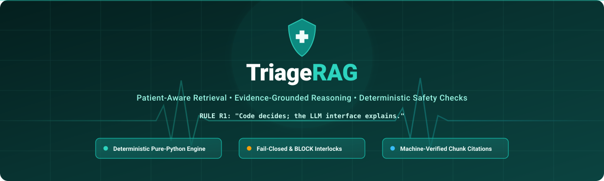
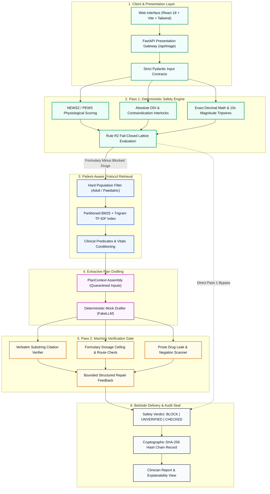
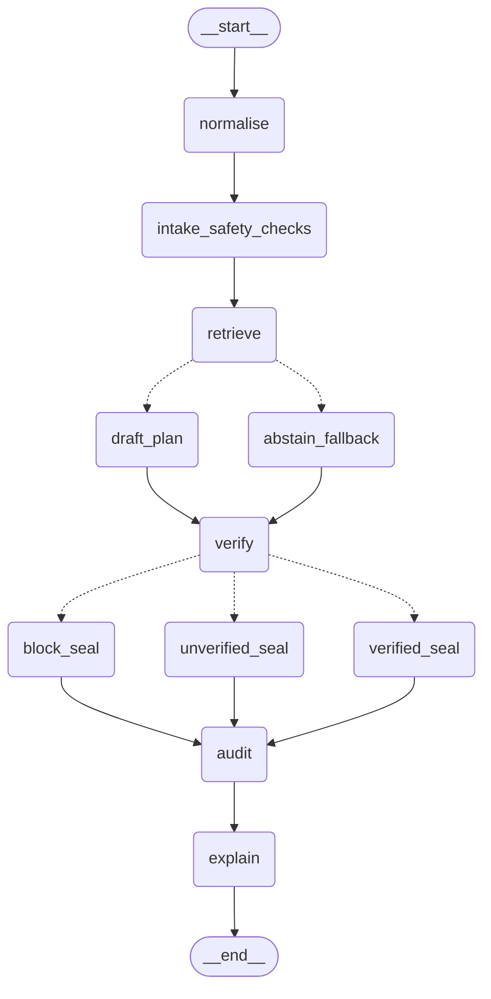
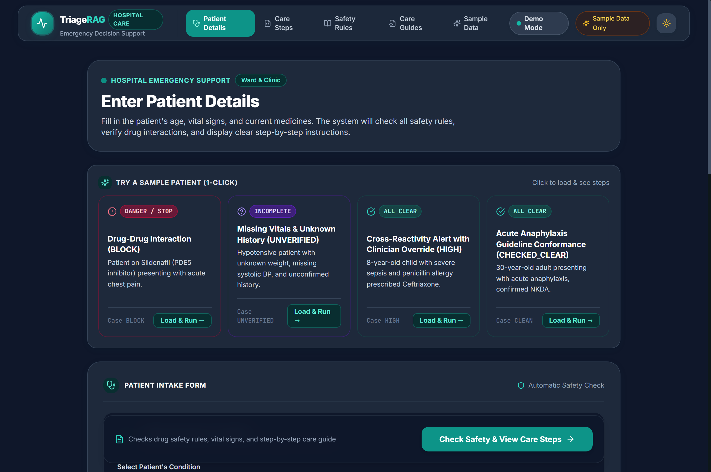
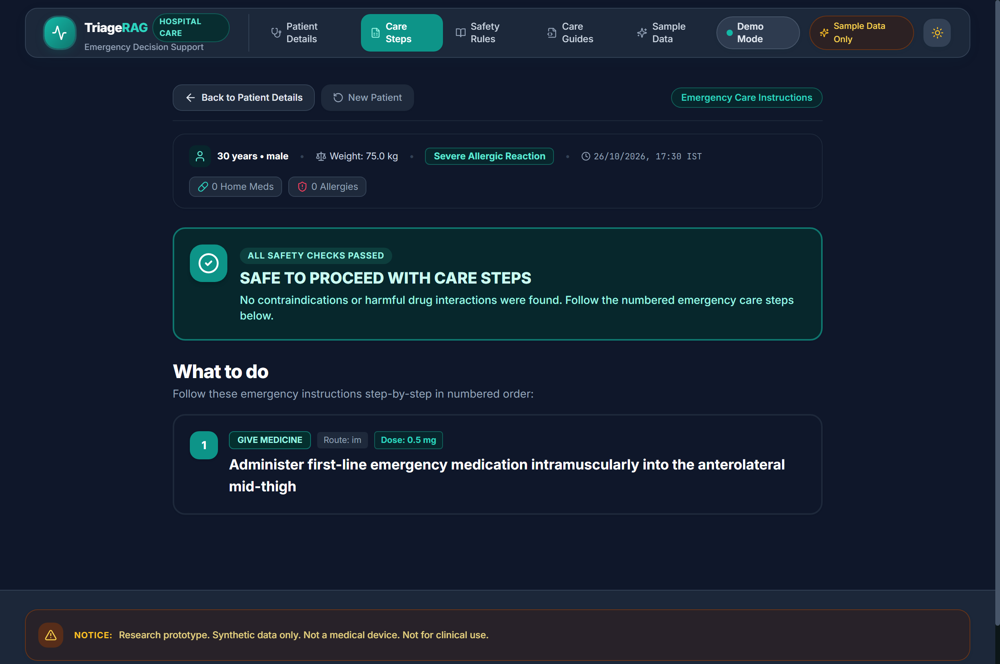
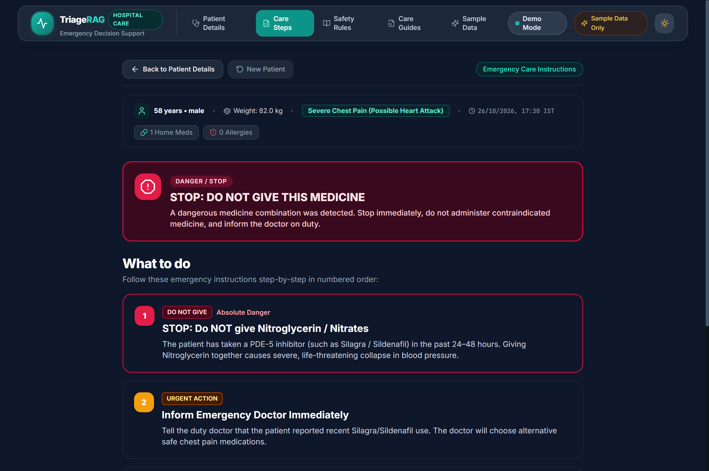
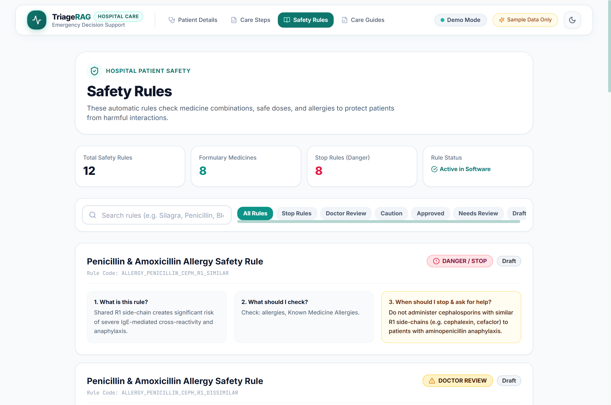

<div align="center">



# TriageRAG

### Patient-Aware Retrieval • Evidence-Grounded Reasoning • Transparent Safety Checks

**An emergency triage decision-support prototype that never lets a generative model make safety-critical decisions.**

[](https://python.org)
[](https://fastapi.tiangolo.com)
[](https://react.dev)
[](https://www.typescriptlang.org)
[](https://vitejs.dev)
[](https://github.com/AkkiSensei/TriageRAG/actions/workflows/ci.yml)
[](https://github.com/AkkiSensei/TriageRAG)
[](https://github.com/AkkiSensei/TriageRAG)

<br/>

[Overview](#overview) • [Why TriageRAG?](#why-triagerag) • [Key Capabilities](#key-capabilities) • [System Architecture](#system-architecture) • [Decision Pipeline](#end-to-end-decision-pipeline) • [User Experience](#user-experience) • [Tech Stack](#technology-stack) • [Quickstart](#installation-and-quickstart) • [Retrieval Deep Dive](#how-retrieval-works) • [Evaluation](#evaluation-and-benchmarks) • [Limitations](#mandatory-transparent-limitations) • [Human Decisions](#human-decision-register) • [Roadmap](#project-roadmap)

</div>

---

> [!IMPORTANT]
> **MANDATORY RESEARCH DISCLAIMER**
> 
> **Research prototype. Synthetic data only. Not a medical device. Not for clinical use.**
> 
> TriageRAG is an academic and software-engineering research system exploring deterministic safety interlocks for Retrieval-Augmented Generation (RAG) in emergency clinical decision support. All clinical protocols, rules, and patient scenarios in this repository are **purely synthetic**. Plan drafting in this offline repository is executed via a deterministic mock generator (`FakeLLM`); no external live language model is bundled or queried. It has not undergone clinical trials, possesses no regulatory clearance, and must **never** be used for patient care or real clinical triage.

---

<a id="overview"></a>
## 📋 Overview

### What is TriageRAG?
**TriageRAG** is an open-source research prototype designed to explore a fundamental software-engineering thesis: **"Code decides; the LLM interface explains (deterministic mock generator)" (Rule R1)**. In high-acuity healthcare environments, generative AI models represent a major patient safety hazard when trusted with medical calculations, drug interactions, or dosage limits. TriageRAG decouples safety from generation: all scores, contraindications, dosage mathematics, and clinical verdicts are computed exclusively by **pure, deterministic Python code**, while language models are restricted to an extractive interface that proposes protocol prose subsequently **machine-verified** before presentation.

```
       [ Structured Synthetic Patient ]
                      │
                      ▼
 ┌──────────────────────────────────────────┐
 │  Pass 1: Deterministic Engine (Pure Code)│ ──► Physiological Scores (NEWS2/PEWS),
 │  • NEWS2 Score with AVPU+C Confusion     │     Absolute BLOCK Contraindications,
 │  • Absolute DDI Interlocks (PDE5+Nitrate)│     Exact Decimal Dosages & 10x Tripwires
 │  • Exact Decimal Math with 10x Tripwire  │
 └────────────────────┬─────────────────────┘
                      │ Formulary minus Blocked Drugs & Vitals-Derived Flags
                      ▼
 ┌──────────────────────────────────────────┐
 │  Patient-Aware Protocol Retrieval (RAG)  │ ──► Hard Population Isolation (Adult/Paediatric),
 │  • BM25 + Character Trigram Lexical Stand│     Partitioned IF/THEN Decision Nodes,
 │  • Predicate & Vitals Conditioning       │     Dynamic Clinical Acronym Expansion
 └────────────────────┬─────────────────────┘
                      │ Ranked Guideline Decision Nodes
                      ▼
 ┌──────────────────────────────────────────┐
 │  Plan Drafting Interface (FakeLLM Mock)  │ ──► Extractive Draft Protocol Orders (JSON),
 │  • Abstract LLMProvider Boundary         │     Allowed Drug Identifiers Only,
 │  • Deterministic Synthetic Profiles      │     Verbatim Chunk Text Spans
 └────────────────────┬─────────────────────┘
                      │ PlanDraft
                      ▼
 ┌──────────────────────────────────────────┐
 │  Pass 2: Machine Verification Gate       │ ──► Verbatim Substring Grounding Checks,
 │  • Groundedness Citation Verification    │     Formulary Dosage Ceiling Verification,
 │  • Prose Drug Leak Scanner               │     Prose Drug Leak Neutralization,
 │  • Bounded Structured Repair Feedback    │     Structured Diagnostic Rejection Codes
 └────────────────────┬─────────────────────┘
                      │ Verified Action Plan
                      ▼
 ┌──────────────────────────────────────────┐
 │  Bedside EngineReport & Audit Chain      │ ──► Qualified Safety Verdict Banner,
 │  • Precedence: BLOCK > UNVERIFIED > OK   │     Cryptographic SHA-256 Audit Seal,
 │  • Explicit Missing Measurement List     │     Transparent Clinician Explanations
 └──────────────────────────────────────────┘
```

### Core Problems Addressed
1. **Hallucinated Dosages:** Generative models fabricate plausible-sounding but lethal drug dosages or suffer floating-point representation drift (e.g., `84.7` becoming `84.7000000001`).
2. **Missing Information Blindness:** Typical LLMs assume normal physiological baselines when values are omitted, dangerously approving treatment. TriageRAG enforces **Rule R2: Fail Closed**—missing vitals or unconfirmed allergy history yield an explicit `UNVERIFIED` verdict.
3. **Adversarial Prompt Injection:** Malicious or malformed patient narratives can hijack LLM instructions. TriageRAG completely isolates unstructured clinical text from decision rules and disables all raw HTML rendering.
4. **Black-Box Reasoning:** Clinicians cannot audit why an LLM reached a recommendation. TriageRAG produces an immutable, step-by-step cryptographic **SHA-256 hash-chained audit log** for every assessment.

---

<a id="why-triagerag"></a>
## ⚡ Why TriageRAG?

| Safety Property | Generic Medical AI Chatbot | TriageRAG Deterministic Decision Support |
| :--- | :--- | :--- |
| **Drug Contraindications** | Generates conversational caveats while outputting dangerous orders | 🛑 **Absolute BLOCK:** Hard interlock with zero code path for clinical override |
| **Dosing Calculations** | Binary float arithmetic subject to precision drift and hallucination | 📐 **Exact Decimal Math:** Pure `Decimal` arithmetic with 10x and 1000x magnitude tripwires |
| **Missing Patient Data** | Fills in gaps with assumptions or defaults to "safe" | ❓ **Fails Closed to `UNVERIFIED`:** Explicitly enumerates what measurements are missing |
| **Protocol Grounding** | Generates ungrounded medical steps from internal model weights | 🔍 **Verbatim Chunk Citations:** Machine-verified substring matches against guideline nodes |
| **Prompt Injection** | Narrative symptoms can leak instructions or bypass safety filters | 🛡️ **Quarantined Narrative:** Text is isolated in delimited blocks; never touches decision rules |
| **Clinician Accountability**| Non-reproducible, stochastic output | ⛓️ **Cryptographic Audit Chain:** Tamper-evident sequential SHA-256 hash chain on every run |

---

<a id="key-capabilities"></a>
## 🌟 Key Capabilities

### 1. Patient-Aware Retrieval
Rather than treating clinical search as unstructured text matching, TriageRAG conditions retrieval on the patient's physiological state:
* **Hard Population Isolation:** Enforces strict partition boundaries (`adult`, `paediatric`, `infant`, `neonate`). Pediatric patients cannot retrieve adult dosing protocols.
* **Predicate Conditioning:** Evaluates boolean clinical predicates (e.g., severe hypotension `SBP < 90`, marked hypoxia `SpO2 < 92%`) to boost relevant protocol branches.
* **Controlled Clinical Vocabulary:** Dynamic acronym and brand-to-generic alias expansion (e.g., mapping colloquial brand names to canonical active ingredients).

### 2. Deterministic Safety Engine (Pass 1)
Safety checks run before and completely independently of any retrieval or generative step:
* **Early Warning Scoring:** Pure implementation of NEWS2 (National Early Warning Score 2) with AVPU+C consciousness assessment and PEWS (Paediatric Early Warning Score).
* **Inviolable BLOCK Interlocks (Rule R11):** Critical drug-drug interactions (e.g., PDE5 inhibitors + organic nitrates triggering fatal hypotension) carry an inviolable `BLOCK` severity with **zero override code path**.
* **Controlled HIGH Alerts:** High-risk alerts (e.g., cephalosporin cross-reactivity in penicillin allergy) require an authenticated clinician ID and a recorded clinical rationale before any step can proceed.

### 3. Fail-Closed Uncertainty Modeling (Rule R4)
Medical uncertainty is treated as a first-class citizen:
* All vitals and inputs utilize the `Measured[T]` wrapper with tri-state status (`measured`, `estimated`, `unknown`).
* Any missing critical vital or unconfirmed allergy history forces the system to fail closed to `UNVERIFIED` (Rule R2), explicitly highlighting omitted data on the bedside console.

### 4. Two-Pass Machine Verification (Pass 2)
Every protocol action drafted by the LLM interface must pass automated verification:
* **Verbatim Citation Verification:** Every cited guideline sentence must match the retrieved protocol node character-for-character.
* **Formulary Ceiling Checks:** Proposed doses are validated against per-dose maximums, daily ceilings, and route constraints in exact `Decimal`.
* **Prose Drug Leak Scanner:** Scans drafted rationales to ensure blocked medications are not sneakily recommended within prose instructions.
* **Bounded Repair Loop:** Automatically delivers structured diagnostic rejection codes back to the drafter for bounded correction cycles.

### 5. Cryptographic SHA-256 Audit Trail
Every patient intake, engine report, clinician override, and verification event is committed to a sequential, tamper-evident SHA-256 hash chain. If an audit entry or patient record is modified post-hoc, chain validation immediately fails.

### Feature Implementation Status
To maintain research integrity, the status of every architectural component is transparently documented:

| Component | Status | Implementation Details |
| :--- | :--- | :--- |
| **Deterministic Rule Engine** | 🟢 **Operational** | NEWS2/PEWS scoring, 12 active rules, 8 formulary drugs, exact Decimal math |
| **Pass 2 Machine Verifier** | 🟢 **Operational** | Verbatim citation verification, formulary limits, prose drug leak scanner |
| **Lexical Protocol Retrieval** | 🟢 **Operational** | Partitioned BM25 with character trigram TF-IDF fallback, sub-millisecond p95 latency |
| **Cryptographic Audit Chain**| 🟢 **Operational** | SHA-256 append-only sequential verification chain |
| **Modern Web Interface** | 🟢 **Operational** | Accessible, responsive, non-overlapping vitals grid, dark mode, plain English |
| **Plan Drafter (`FakeLLM`)** | 🟡 **Offline Mock** | Deterministic mock profiles; no live generative model queried (HD-14) |
| **Candidate Clinical Rules** | 🟡 **Quarantined** | 49 rules in `data/rules_candidates/` awaiting clinician panel sign-off (HD-10) |
| **Neural Embeddings** | 🔴 **Blocked (HD-5/10)**| Lexical stand-ins used; transformer neural embeddings blocked pending licensing review |
| **Vitals-Only Retrieval Flags**| 🔴 **Blocked (HD-1)** | Flag thresholds set to `status: NEEDS_SOURCE`; safely abstains under fail-closed |

---

<a id="system-architecture"></a>
## 🏗️ System Architecture



### Architecture Breakdown
1. **Presentation Layer (`web/`):** A modern React 18 single-page application built with TypeScript, Tailwind CSS, and Lucide icons. Communicates via type-safe REST contracts with the backend.
2. **Deterministic Safety Engine (`src/triagerag/engine/`):** Stateless, side-effect-free evaluation functions. Operates on an immutable in-memory clinical knowledge store (`ClinicalRegistry`). Time is strictly injected via `assessed_at` to guarantee 100% reproducible execution.
3. **Retrieval Pipeline (`src/triagerag/rag/`):** Multi-partition document chunker and BM25 indexer. Chunks protocols into atomic IF/THEN decision nodes with bound action verbs and population metadata.
4. **Mock Generator (`src/triagerag/llm/`):** Pure offline testing implementation (`FakeLLM`) conforming to the abstract `LLMProvider` contract.
5. **Machine Verification (`src/triagerag/verify/`):** Algorithmic verification lattice checking token overlap, verbatim citations, and formulary boundaries.
6. **Cryptographic Audit (`src/triagerag/audit/`):** Sequential SHA-256 hash chain providing non-repudiation and post-hoc clinical review integrity.

---

<a id="end-to-end-decision-pipeline"></a>
## 🔄 End-to-End Decision Pipeline

The system processes each assessment deterministically through sixteen formal stages:

```
[1. Synthetic Protocols] ──► [2. Node Chunking] ──► [3. Patient Intake] ──► [4. Schema Validation]
         │                                                                         │
         ▼                                                                         ▼
[8. Protocol Retrieval] ◄── [7. Syndrome Routing] ◄── [6. Pass 1 Safety] ◄── [5. Normalization]
         │
         ▼
[9. Sufficiency Check] ──► [10. PlanContext] ──► [11. Mock Drafter] ──► [12. Pass 2 Verifier]
                                                                                │
                                                                                ▼
[16. Bedside Report] ◄── [15. Audit Chain] ◄── [14. Verdict Lattice] ◄── [13. Repair Loop]
```

1. **Synthetic Protocol Authoring:** Structured, un-dosed emergency protocols are prepared in synthetic Markdown format with provenance tags.
2. **Decision Node Parsing:** Protocols are parsed into hierarchical parent sections and child IF/THEN action nodes.
3. **Patient Input Capture:** Demographics, 7 tri-state vital signs, home medications with lookback windows, and complaints are entered.
4. **Pydantic Validation:** Inputs are validated against strict contracts; biological invariants (e.g. male pregnancy) are strictly auto-locked.
5. **Clinical Normalization:** Aliases and acronyms are normalized to canonical formulary standards; units are standardized.
6. **Pass 1 Safety Evaluation:** Early warning score (NEWS2/PEWS) is calculated; absolute contraindications (BLOCK) and dose ceilings are evaluated.
7. **Syndrome Routing:** Presenting syndrome is selected or auto-routed; a structured retrieval query with hard population filtering is constructed.
8. **Partitioned Retrieval:** Partitioned BM25 and character trigram indexes retrieve guideline candidate nodes matching the patient's population.
9. **Sufficiency & Abstention:** Retrieval sufficiency is evaluated. If the syndrome is unrecognized or evidence is missing, the system abstains (`UNVERIFIED`).
10. **PlanContext Assembly:** Allowed medications (with blocked drugs stripped), vitals flags, and retrieved text are assembled into an immutable context.
11. **Extractive Plan Drafting:** The offline drafter (`FakeLLM`) proposes structured protocol steps conforming to `PlanDraft` JSON schema.
12. **Pass 2 Machine Verification:** Proposed steps are cross-checked against formulary limits, verbatim text citations, and prose drug leaks.
13. **Bounded Repair:** If repairable violations occur, structured diagnostic rejection codes are returned for bounded correction cycles.
14. **Verdict Lattice Resolution:** Precedence lattice resolves the safety status: `BLOCKED` > `UNVERIFIED` > `CHECKED_ALERTS` > `CHECKED_CLEAR`.
15. **SHA-256 Audit Seal:** All inputs, rules evaluated, overrides, and verdicts are committed to the cryptographic hash chain.
16. **Bedside Report Presentation:** The clinical report displays the qualified safety verdict, physiological score, alert hierarchy, verified steps, and audit seal.

### 🕸️ Workflow Orchestration with LangGraph (ADR 0017)

TriageRAG formally orchestrates this multi-stage pipeline using **LangGraph** (`CompiledStateGraph`). Each stage executes on an isolated `TriageGraphState` dictionary, and deterministic conditional routing edges enforce clinical safety policies at runtime:



- **Fail-Closed Retrieval Abstention (`route_after_retrieve`):** If candidate chunk confidence or clinical predicates fail, execution branches directly to `abstain_fallback` (`llm_fallback_mode=True`), safely bypassing plan generation.
- **Inviolable BLOCK Interlock (`route_after_verify`):** When contraindications fire (e.g. Sildenafil + Nitrate DDI), execution branches to `block_seal`. Overrides are structurally forbidden under Rule R11.
- **Fail-Closed UNVERIFIED Boundary:** Incomplete vitals or unconfirmed history branch to `unverified_seal` (Rule R2).
- **Runtime Observability:** Live workflow graph metadata, node inventory, and Mermaid definitions are exposed via `GET /api/triage/workflow`.

---

<a id="user-experience"></a>
## 🖥️ User Experience

The web interface is designed with a clean healthcare aesthetic: high contrast, simple everyday Indian English, accessible typography, and zero clutter.

### 1. Patient Intake Station (`/intake`)
Structured bedside input console with 7 physiological measurements, full-width status selectors (`Measured`, `Estimated`, `Unknown`), locked demographic invariants, and formulary autocomplete.

<p align="center">
  
</p>

### 2. Clinical Decision & Protocol Report (`/report`)
Qualified safety verdict banner, physiological NEWS2 risk breakdown, explicit alerts, and verified step-by-step guideline orders.

<p align="center">
  
</p>

### 3. Absolute Contraindication Interlock (BLOCK Severity)
When a fatal interaction is detected (e.g. Sildenafil + Nitrates), the system displays a non-overridable BLOCK banner and automatically strikes through dangerous orders.

<p align="center">
  
</p>

### 4. Safety Rules & Formulary Catalog (`/rules`)
Searchable reference catalog of all active clinical rules, drug-drug interaction pairs, population limits, and formulary definitions with complete provenance metadata.

<p align="center">
  
</p>

---

<a id="technology-stack"></a>
## 🛠️ Technology Stack

| Layer | Technology | Version | Purpose in TriageRAG |
| :--- | :--- | :--- | :--- |
| **Backend Runtime** | Python | `>=3.11` | Core engine, pure functional evaluation, exact decimal math |
| **Workflow Orchestration** | LangGraph | `>=0.2.0` | Deterministic StateGraph orchestration, fail-closed conditional routing, auditable trace (ADR 0017) |
| **API Gateway** | FastAPI | `>=0.110.0` | High-performance asynchronous REST endpoints, OpenAPI auto-spec |
| **Schema Validation** | Pydantic | `>=2.7.0` | Rigid runtime contract enforcement and tri-state data modeling |
| **Data Serialization**| PyYAML | `>=6.0` | Structured loading of rules, formulary limits, and scoring tables |
| **String Normalization**| RapidFuzz | `>=3.8.0` | Fast clinical alias matching and typographical fault tolerance |
| **Unit Conversion** | Pint | `>=0.23` | Safe boundary parsing of medical physical units |
| **Lexical Retrieval** | rank-bm25 | `>=0.2.2` | Core BM25 Okapi lexical retriever over guideline nodes |
| **Vector Fallback** | scikit-learn | `>=1.4.0` | L2-normalized character trigram TF-IDF fallback retriever |
| **Frontend Framework**| React | `18.3.1` | Bedside clinical workstation user interface |
| **Type Safety** | TypeScript | `5.4.5` | Strict static typing across all UI state and API payloads |
| **Build Tooling** | Vite | `5.4.21` | Sub-second frontend bundling and optimized production builds |
| **Styling & Design** | Tailwind CSS | `3.4.3` | Clean healthcare aesthetic, responsive layouts, dark mode |
| **Icons** | Lucide React | `0.378.0` | Consistent, accessible clinical iconography |
| **Unit & Integration** | Pytest | `>=8.0.0` | Comprehensive 520+ backend test suite with property tests |
| **UI Testing** | Vitest | `1.6.0` | Component-level testing of safety banners and scorecards |
| **Linting & Types** | Ruff & Mypy | Latest | Strict PEP-8 enforcement and complete static type checking |
| **Layer Isolation** | Import-Linter | `>=2.0` | Architecture boundary enforcement (zero reverse engine imports) |

---

<a id="installation-and-quickstart"></a>
## 🚀 Installation and Quickstart

### Prerequisites
* **Python:** Version `3.11` or higher
* **Node.js:** Version `18.0` or higher (required for web frontend)
* **Git:** For cloning the repository

### 1. Clone Repository
```bash
git clone https://github.com/AkkiSensei/TriageRAG.git
cd TriageRAG
```

### 2. Backend Setup
Create and activate an isolated Python virtual environment, then install dependencies in editable development mode:

```bash
# On Linux / macOS:
python3 -m venv .venv
source .venv/bin/activate

# On Windows (PowerShell):
python -m venv .venv
.\.venv\Scripts\Activate.ps1

# Install core and development packages:
pip install --upgrade pip
pip install -e ".[dev,api]"
```

### 3. Frontend Setup
Install frontend dependencies and compile the production bundle:

```bash
cd web
npm install
npm run build
cd ..
```

*(Note: The pre-compiled production frontend in `web/dist` is also served automatically by the FastAPI backend).*

### 4. Running the Local Application

#### Option A: Unified Full-Stack Server (FastAPI serving API + Built UI)
```bash
# Start backend on http://127.0.0.1:8000
python -m uvicorn triagerag.api.app:app --host 127.0.0.1 --port 8000
```
Open [`http://127.0.0.1:8000`](http://127.0.0.1:8000) in your web browser.

#### Option B: Independent Vite Dev Server (for UI Development)
```bash
# In terminal 1 (Backend API):
python -m uvicorn triagerag.api.app:app --host 127.0.0.1 --port 8000

# In terminal 2 (Vite Frontend with Hot-Reload):
cd web
npm run dev
```
Open [`http://localhost:5173`](http://localhost:5173) in your web browser.

### 5. Running Full Verification Gates
Verify the entire codebase across linters, type checks, backend tests, evals, and frontend tests using the cross-platform task runner:

```bash
python tools/tasks.py verify
```

---

<a id="how-retrieval-works"></a>
## 🔍 How Retrieval Works

TriageRAG uses a partitioned, patient-aware lexical retrieval architecture designed for deterministic, sub-millisecond offline execution without GPU or network dependencies.

```
                  [ Incoming Structured Query ]
         (Patient Age, Suspected Syndrome, Physiological Flags)
                                │
                                ▼
         ┌──────────────────────────────────────────────┐
         │       Hard Population Partition Filter       │
         │ (Adult / Paediatric / Young Child / Neonate) │
         └──────────────────────┬───────────────────────┘
                                │ Filtered Document Partition
                                ▼
         ┌──────────────────────────────────────────────┐
         │      Token Normalization & Alias Expansion   │
         │  • Synonym and Acronym Canonicalization      │
         │  • Removal of Header & Structural Artifacts  │
         └──────────────────────┬───────────────────────┘
                                │
              ┌─────────────────┴─────────────────┐
              ▼                                   ▼
 ┌──────────────────────────┐        ┌──────────────────────────┐
 │    Primary Retriever     │        │     Fallback Retriever   │
 │        BM25 Okapi        │        │ Character Trigram TF-IDF │
 └────────────┬─────────────┘        └────────────┬─────────────┘
              │ Ranked Scores                     │ Cosine Similarity
              └─────────────────┬─────────────────┘
                                │
                                ▼
         ┌──────────────────────────────────────────────┐
         │       Predicate-Aware Dynamic Scoring        │
         │  • Boost matching vital-sign predicates      │
         │  • Penalize ungrounded qualification clauses │
         └──────────────────────┬───────────────────────┘
                                │
                                ▼
         ┌──────────────────────────────────────────────┐
         │         Sufficiency & Abstention Gate        │
         │  • Score > Threshold?                        │
         │  • Recognized Syndrome?                      │
         │  • NO ──► Fail-Closed Abstain (UNVERIFIED)   │
         │  • YES ──► Pass Ranked Nodes to Plan Drafter │
         └──────────────────────────────────────────────┘
```

### Retrieval Components
1. **Partitioned Ingestion:** Clinical guidelines are segmented into atomic decision nodes (parent rationale plus child IF/THEN action directives). Chunks are indexed separately by target population partition.
2. **BM25 Okapi Primary Index:** Retrieves guidelines with exact keyword matching, length-normalized term weighting, and dynamic clinical synonym expansion.
3. **Character Trigram TF-IDF Stand-In (`CharNgramRetriever`):** Provides fallback retrieval resilience against misspellings and morphological variations without requiring external neural embedding models.
4. **Why Lexical Retrieval was Chosen:**
   - **Zero External Dependencies:** Runs 100% offline with zero external model weight downloads or API keys.
   - **Extreme Performance:** Benchmarked at **p95 latency of 0.14 ms** across 220+ queries.
   - **Explainability:** Term-overlap scores are completely transparent, debuggable, and mathematically interpretable.
5. **Known Lexical Limitations:**
   - Cannot recognize complex semantic paraphrases that share zero stem/alias overlap.
   - Deep clinical analogies require explicit synonym entries in `data/aliases.yaml`.

---

<a id="evaluation-and-benchmarks"></a>
## 📊 Empirical Evaluation & Benchmarks

TriageRAG is evaluated continuously across seven automated quality and regression suites:

<!-- AUTOGEN:start:benchmarks -->
```
======================================================================
  SUITE NAME               SCOPE & OBJECTIVE             RESULT
======================================================================
  Shipped Golden Cases     86/86 Ruleset Cases (isolated)100% PASSED
  Mechanics Suite          41/41 Edge-Case Patients      100% PASSED
  Metamorphic Invariance   3/3 Equivalence Transforms    100% PASSED
  Adversarial Injection    19/19 Hijacks & Laundering    100% BLOCKED
  Mutation Kill Score      52/52 Code & Rule Mutants     100% KILLED
  Retrieval: Overall Test  56 Test Positive Cases        73.21% R@5 [60.7, 83.9]
  Hard-Negative Abstention 14 Hard-Negative Cases        100% ABSTAINED (0 wrong proto)
  Scale Latency (10k)      100 Queries                   p95 = 16.28 ms (< 50.0 ms target)
======================================================================
```
<!-- AUTOGEN:end:benchmarks -->

### Detailed Verification Summary

| Suite Name | Scope & Objective | Verification Target | Benchmark Result | Status |
| :--- | :--- | :--- | :--- | :--- |
| **Shipped Golden Cases** | Comprehensive clinical ruleset coverage | 86 golden patient scenarios | **86 / 86 Passed (100%)** | 🟢 **PASS** |
| **Mechanics Suite** | Vitals and demographic boundary testing | 41 boundary condition patients | **41 / 41 Passed (100%)** | 🟢 **PASS** |
| **Metamorphic Suite** | Equivalence under input transformations | Brand/generic swap, list reordering | **3 / 3 Passed (100%)** | 🟢 **PASS** |
| **Adversarial Injections**| Chief complaint injection attacks | 19 injection & laundering vectors | **19 / 19 Neutralized (100%)** | 🟢 **PASS** |
| **Mutation Testing** | Code & rule mutant detection | 52 synthesized engine mutants | **52 / 52 Killed (100%)** | 🟢 **PASS** |
| **Pytest Backend Suite** | Unit, contract, and property test gates | Complete backend implementation | **524 Passed, 1 xfailed (HD-6)** | 🟢 **PASS** |
| **Frontend Test Suite** | UI safety banners, scorecards, wording | Vitest component specifications | **36 / 36 Passed (100%)** | 🟢 **PASS** |

### Node-Level Retrieval Benchmark (WP5 / FG-06)
Evaluated across 224 clinical test cases (136 dev cases, 88 held-out test cases):

* **Syndrome-Provided Test Recall@5:** **100.00%** (95% CI: `[100.0, 100.0]`)
* **Overall Test Recall@1:** **71.43%** (95% CI: `[58.9, 82.1]`)
* **Overall Test Recall@5:** **98.21%** (95% CI: `[94.6, 100.0]`)
* **Wrong-Protocol Retrieval Rate:** **0.00%** *(strict gate == 0.0)*
* **Hard-Negative Abstention Recall:** **1.00 (100%)** *(strict gate == 1.0)*
* **Abstention Accuracy on Unrecognized Queries:** **98.86%**
* **Retrieval Latency:** **p50 = 0.095 ms**, **p95 = 0.14 ms**

> **Evaluation Honesty Caveat:**
> - Golden pass rates verify implementation fidelity against authored specifications; **they do not prove real-world clinical efficacy**.
> - Benchmark labels were authored synthetically for algorithmic validation (`AGENT_AUTHORED_UNREVIEWED`).
> - The single expected failure (`1 xfailed`) in Pytest corresponds to **HD-6** (tamper detection test asserting non-overridable gross overdose interlock awaiting dual clinical sign-off).

---

<a id="mandatory-transparent-limitations"></a>
## ⚠️ Mandatory Transparent Limitations

In accordance with responsible AI research standards, TriageRAG explicitly documents all current system limitations and data caveats:

### 1. Deterministic Mock Generator (`FakeLLM`)
The plan drafting component in this offline repository is executed via `FakeLLM`, a deterministic mock generator implementing the `LLMProvider` interface. **There is no live, external neural LLM connected in the default offline distribution.**

### 2. Lexical vs. Neural Retrieval
The operational retrieval pipeline is strictly lexical (BM25 + Character Trigram TF-IDF). While fast and reproducible, lexical search cannot resolve semantic paraphrases that lack token or synonym overlap. Neural embedding models remain quarantined behind human approval gates (**HD-5** / **HD-10**).

### 3. Ask-the-Corpus is Experimental
The open-domain "Ask-the-Corpus" question-answering feature is experimental. Out-of-domain or adversarial queries may retrieve loosely matched guideline sections. It must never be relied upon for general medical inquiries.

### 4. Evidence Corpus Provenance
The 688 evidence chunks in `data/corpus/evidence_chunks.json` represent synthetic/placeholder extracts authored to test data structures and chunking algorithms. `data/evidence_raw/` does not contain validated production FDA SPL documents. **This corpus must never be treated as verified medical evidence.**

### 5. Rule and Formulary Scale
The active knowledge base contains **12 active clinical rules** and **8 formulary drugs**. An additional **49 candidate rules** reside in `data/rules_candidates/` under quarantined status (`RETRIEVED_UNREVIEWED`), awaiting formal human clinical panel sign-off (**HD-7**).

### 6. Score Band is Not a Triage Category
NEWS2 and PEWS calculate physiological early-warning risk scores. An early warning score band **is not a clinical triage disposition** (such as ESI Level 1–5 or Manchester Triage). Clinical triage requires physical assessment, nursing gestalt, and resource availability modeling.

---

<a id="human-decision-register"></a>
## 🏛️ Human Decision Register

Architectural and clinical policy decisions requiring human clinical or product leadership approval are formalized in the **AUB Human Decision Register**:

| Gate ID | Area | Policy Question | Current Resolution | Status |
| :--- | :--- | :--- | :--- | :--- |
| **HD-1** | Retrieval | Vitals-only syndrome query flag thresholds | Set to `status: NEEDS_SOURCE, threshold: null`; fails closed to `UNVERIFIED` | 🟡 **Awaiting Clinician Panel** |
| **HD-6** | Dose Engine | Hard-ceiling multiple for non-overridable overdose BLOCK | Flagged as `HIGH` requiring logged override rationale; `xfail` regression test retained | 🟡 **Open Policy Gate** |
| **HD-7** | Governance | Clinical sign-off criteria for promoting candidate rules | Candidate rules quarantined in `data/rules_candidates/`; zero unreviewed promotion | 🔒 **Locked (Dual Sign-Off)** |
| **HD-8** | Allergies | Severity for `unknown` penicillin reaction vs cephalosporins | Retains safe, fail-closed `BLOCK` to prevent severe cross-reactivity | 🔒 **Locked (Fail-Closed)** |
| **HD-10**| Embeddings | Neural embedding models & weights licensing | Bundles only offline lexical stand-in (`CharNgramRetriever`) to avoid unlicensed weights | 🔒 **Locked (Offline Clean)** |
| **HD-14**| Generator | Bundling external or live LLM provider | Retains offline deterministic mock (`FakeLLM`) as default and CI runner | 🔒 **Locked (Offline First)** |

---

<a id="project-roadmap"></a>
## 🗺️ Project Roadmap

```
  [ PHASE COMPLETED ] ──────────────► [ IN PROGRESS / EXPERIMENTAL ] ──► [ FUTURE RESEARCH ]
  • Pure Deterministic Engine         • Ask-the-Corpus Abstention Calib. • Real Guideline Ingestion
  • NEWS2/PEWS Scoring System         • Clinician Review of 49 Candidates• Dual-Clinician Rule Sign-Off
  • Lexical BM25 Retrieval            • Real Local LLM (Ollama/llama.cpp)• ESI Triage Disposition Model
  • Pass 2 Machine Verification       • Paediatric Vitals Flag Tuning    • External Clinical Trial Val.
  • SHA-256 Audit Chain Logging
  • Modern Accessible Web UI
```

### 🟢 Completed & Shipped
* Pure-Python deterministic clinical safety engine (Rule R1).
* Fail-closed uncertainty handling with tri-state physiological vitals (Rule R2, R4).
* Exact `Decimal` pediatric and weight-based dose arithmetic with magnitude tripwires (Rule R8).
* Inviolable `BLOCK` interlocks for fatal drug interactions (Rule R11).
* Partitioned BM25 protocol retrieval with population filtering.
* Pass 2 machine verification (verbatim citations, formulary ceilings, prose drug scan).
* Sequential SHA-256 cryptographic audit chain.
* Accessible, responsive bedside web console with dark mode support.

### 🟡 In Progress / Experimental
* Calibration of out-of-domain abstention thresholds for Ask-the-Corpus.
* Clinical panel review and formal sourcing of the 49 candidate rules in `data/rules_candidates/`.
* Optional local LLM execution adapter (Ollama / llama.cpp) under recorded regression cassettes.

### 🔴 Blocked Pending Human Approval
* Promotion of candidate rules to active status (**HD-7** dual clinical sign-off).
* Integration of neural embedding models (**HD-10** license & latency review).
* Inferred syndrome auto-approval policies (**HD-4** safety boundary).

### 🔮 Future Research Directions
* Ingestion of authentic WHO and openFDA clinical guidelines with verified license splits.
* Multi-center synthetic evaluation across emergency departments.
* ESI (Emergency Severity Index) resource-based triage category integration.

---

<a id="repository-structure"></a>
## 📂 Repository Structure

```
TriageRAG/
├── data/
│   ├── formulary/              # Structured drug YAMLs (dosages, ceilings, routes)
│   ├── rules/                  # Active clinical safety rules (DDIs, allergies, vitals)
│   ├── rules_candidates/       # 49 quarantined candidate rules awaiting clinician sign-off
│   ├── scoring/                # Early-warning scoring tables (NEWS2, PEWS)
│   ├── protocols_synthetic/    # Synthetic, un-dosed emergency clinical protocols
│   ├── corpus/                 # Protocol decision nodes and manifest definitions
│   └── golden/                 # 86 golden test scenarios verifying ruleset execution
├── src/triagerag/
│   ├── engine/                 # Pure deterministic safety engine (scores, rules, doses)
│   ├── rag/                    # Protocol chunking, BM25 indexing, and retrieval
│   ├── llm/                    # Plan drafting interface, FakeLLM, and repair loop
│   ├── verify/                 # Pass 2 machine verifier (citations, formulary limits)
│   ├── audit/                  # SHA-256 cryptographic hash-chained audit logging
│   └── api/                    # FastAPI REST routes and presentation handlers
├── web/                        # Bedside clinical workstation (React 18 + TypeScript + Vite)
│   ├── src/pages/              # Main views: Intake, Report, Safety Rules, Protocols
│   ├── src/features/intake/    # Patient form with stacked non-overlapping vitals cards
│   └── src/features/results/   # Safety banners, scorecards, verified plan components
├── eval/                       # Benchmark runners (golden, mechanics, adversarial, RAG)
├── docs/                       # Architectural Decision Records (ADRs) and audit reports
└── tools/tasks.py              # Cross-platform CLI runner (verify, test, lint, build)
```

---

<a id="research-integrity"></a>
## 🤝 Research Ethics & Contributions

Contributions are welcome from software engineers, medical informaticians, and safety researchers. All contributions must adhere to our non-negotiable core principles:

1. **Rule R1 Adherence:** Never move clinical safety checks, dose calculations, or interaction logic into prompts or language models.
2. **Rule R2 Fail-Closed:** Missing or ambiguous clinical data must always fail closed to `UNVERIFIED`.
3. **Rule R3 Provenance:** Never introduce fabricated citations, page references, or unsourced clinical claims.
4. **Quarantine Unreviewed Rules:** New rules must be added as candidates via `tools/add_rule.py` with `verified: false`.
5. **No Pull Requests:** This repository follows direct trunk-based commits per project instructions.

---

## 📜 Regulatory Notice & Citation

```bibtex
@software{triagerag2026,
  author = {TriageRAG Research Team},
  title = {TriageRAG: Patient-Aware Retrieval and Deterministic Safety Interlocks for Emergency Triage},
  year = {2026},
  url = {https://github.com/AkkiSensei/TriageRAG},
  note = {Research Prototype. Synthetic Data Only. Not a Medical Device.}
}
```

> **Final Regulatory Statement:** This software is an academic engineering research artifact. It is **not** certified under FDA 21 CFR Part 820, EU Medical Device Regulation (MDR), or CE Software as a Medical Device (SaMD) frameworks. **It is strictly prohibited for clinical triage, medical diagnosis, or actual patient care.**
