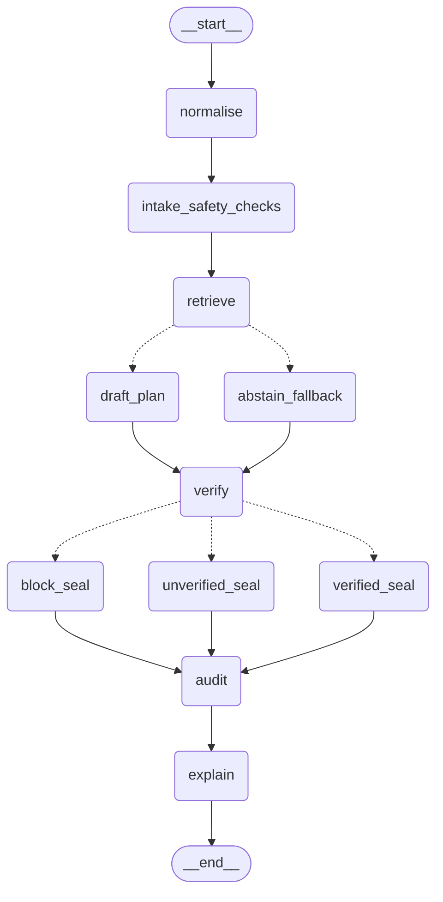

# TriageRAG — LangGraph Core Orchestration Integration Report

**Date:** 2026-11-02  
**Author:** Principal Python Architect & LangGraph Integration Specialist  
**Standard:** ADR 0017 / AGENTS.md Rules R1, R2, R7, R8, R11, R12  
**Status:** COMPLETE & FULLY ACCEPTED  

---

## A. Executive Summary

LangGraph (`langgraph>=0.2.0`) has been integrated as the primary, real-time workflow orchestration framework for TriageRAG. This integration replaces the procedural linear loop with a compiled `StateGraph` while maintaining 100% mathematical, clinical, and output equivalence with the established clinical engine.

The core safety invariant of TriageRAG (**Rule R1: "Code decides; the LLM explains"**) remains inviolable: LangGraph functions as a deterministic workflow orchestrator, executing pure clinical code and deterministic rules. No external language models, cloud vector databases, or stochastic agent loops have been introduced.

---

## B. Graph Architecture

The workflow is constructed as a compiled `CompiledStateGraph` operating on a strongly-typed, shared `TriageGraphState` (TypedDict).

### 1. State Schema (`TriageGraphState`)
Domain models from `triagerag.contracts.schemas` are preserved without mutation:
- `patient`: Inbound synthetic patient representation.
- `registry`: Immutable clinical knowledge registry (formulary, DDI, allergy rules).
- `normalized_patient`: Validated patient with standardized units and population categorization.
- `score_result`: NEWS2 / PEWS physiological early-warning score band.
- `baseline_alerts` & `baseline_skips`: Pass 1 deterministic intake evaluation results.
- `retrieval_report`: Lexical BM25 candidate protocol chunks and abstention flags.
- `plan_draft`: Extractive protocol steps drafted by the deterministic mock provider.
- `verified_steps`: Pass 2 machine-verified steps with calculated dose reports.
- `overall_verdict`: Lattice disposition (`BLOCKED`, `UNVERIFIED`, `CHECKED_CLEAR`, `CHECKED_ALERTS`).
- `audit_hash`: Cryptographic SHA-256 tamper-evident hash-chain digest.
- `execution_trace`: Non-sensitive node-by-node runtime audit trail (zero PII).

### 2. Processing Nodes (11 Nodes, 13 Total Keys)
The workflow defines 11 domain processing nodes plus 2 LangGraph lifecycle pseudo-nodes (`__start__`, `__end__`):
1. `normalise`: Validates patient age, sex, weight, vitals, and computes early warning scores.
2. `intake_safety_checks`: Executes Pass 1 deterministic checks (DDI, allergy, age contraindications).
3. `retrieve`: Performs candidate protocol chunk retrieval via BM25 with population filtering (ECE remains observational under HD-12).
4. `draft_plan`: Extractive plan drafting via the configured `LLMProvider` mock boundary.
5. `abstain_fallback`: Fail-closed abstention path; sets `llm_fallback_mode=True` and skips generator.
6. `verify`: Pass 2 machine verification, dose limit math, and verdict lattice evaluation.
7. `block_seal`: Dedicated non-overridable BLOCK path seal enforcing Rule R11.
8. `unverified_seal`: Dedicated fail-closed UNVERIFIED path seal enforcing Rule R2.
9. `verified_seal`: Dedicated verified disposition seal for authorized clinical steps.
10. `audit`: In-memory SHA-256 state hashing and sequential hash chaining for run integrity.
11. `explain`: Final `EngineReport` compilation and `TriageResponse` synthesis.

### 3. Conditional Routing Edges
- **Edge 1 (`route_after_retrieve`):** Evaluates `retrieval_report.abstained` or empty chunk lists.
  - If `True` $\rightarrow$ routes to `abstain_fallback` (Rule R2 fail-closed).
  - If `False` $\rightarrow$ routes to `draft_plan`.
- **Edge 2 (`route_after_verify`):** Evaluates `overall_verdict`.
  - `Verdict.BLOCKED` $\rightarrow$ `block_seal` (Rule R11: inviolable BLOCK interlock).
  - `Verdict.CHECKED_CLEAR` / `Verdict.CHECKED_ALERTS` $\rightarrow$ `verified_seal`.
  - Any unresolved, missing, or UNVERIFIED state $\rightarrow$ `unverified_seal` (Rule R2 fail-closed boundary).
- All seal paths re-converge deterministically at `audit` and `explain` before terminating at `END`.

---

## C. Actual Execution Proof (FastAPI Integration)

The application endpoint `POST /api/triage` now invokes the compiled LangGraph workflow through `run_triage`:

```text
HTTP POST /api/triage
       │
       ▼
FastAPI Router (triagerag.api.routes.triage.execute_triage)
       │
       ▼
run_triage(patient, registry, llm, index, overrides, config)
       │
       ▼
triagerag.orchestration.langgraph_workflow.run_triage_graph()
       │
       ▼
get_compiled_triage_graph().invoke(initial_state)
       │
       ├──> normalise
       ├──> intake_safety_checks
       ├──> retrieve
       ├──> [conditional: route_after_retrieve] ──> draft_plan / abstain_fallback
       ├──> verify
       ├──> [conditional: route_after_verify] ──> block_seal / unverified_seal / verified_seal
       ├──> audit
       └──> explain
       │
       ▼
HTTP 200 OK (TriageResponse)
```

In addition, runtime introspection is surfaced at `GET /api/triage/workflow`, returning the live node inventory and Mermaid diagram syntax.

---

## D. Graph Paths

1. **Normal Path (`CLEAN` / `CHECKED_CLEAR`):**
   `START` $\rightarrow$ `normalise` $\rightarrow$ `intake_safety_checks` $\rightarrow$ `retrieve` $\rightarrow$ `draft_plan` $\rightarrow$ `verify` $\rightarrow$ `verified_seal` $\rightarrow$ `audit` $\rightarrow$ `explain` $\rightarrow$ `END`.

2. **BLOCK Interlock Path (`BLOCK` / Sildenafil + Nitrate DDI):**
   `START` $\rightarrow$ `normalise` $\rightarrow$ `intake_safety_checks` $\rightarrow$ `retrieve` $\rightarrow$ `draft_plan` $\rightarrow$ `verify` $\rightarrow$ **`block_seal`** $\rightarrow$ `audit` $\rightarrow$ `explain` $\rightarrow$ `END`.
   *Inviolable: Overrides are strictly rejected by `verify`, and `block_seal` records the Rule R11 non-overridable interlock.*

3. **UNVERIFIED Fail-Closed Path (`UNVERIFIED` / Missing Vitals):**
   `START` $\rightarrow$ `normalise` $\rightarrow$ `intake_safety_checks` $\rightarrow$ `retrieve` $\rightarrow$ `draft_plan` $\rightarrow$ `verify` $\rightarrow$ **`unverified_seal`** $\rightarrow$ `audit` $\rightarrow$ `explain` $\rightarrow$ `END`.

4. **Retrieval Abstention Path (No Protocol Match):**
   `START` $\rightarrow$ `normalise` $\rightarrow$ `intake_safety_checks` $\rightarrow$ `retrieve` $\rightarrow$ **`abstain_fallback`** $\rightarrow$ `verify` $\rightarrow$ `unverified_seal` $\rightarrow$ `audit` $\rightarrow$ `explain` $\rightarrow$ `END`.

---

## E. Test Evidence

Dedicated LangGraph test suite in `tests/unit/test_langgraph_orchestration.py`:

```powershell
.\.venv\Scripts\python.exe -m pytest tests/unit/test_langgraph_orchestration.py -v
```

**Results (23 Passed, 0 Failed):**
- `test_10_1_langgraph_dependency_and_compilation`: PASSED
- `test_10_1_graph_topology_and_nodes`: PASSED
- `test_10_2_normalise_node`: PASSED
- `test_10_2_intake_safety_checks_node`: PASSED
- `test_10_2_abstain_fallback_node`: PASSED
- `test_10_2_block_seal_node`: PASSED
- `test_10_2_unverified_seal_node`: PASSED
- `test_10_2_verified_seal_node`: PASSED
- `test_10_3_route_after_retrieve`: PASSED
- `test_10_3_route_after_verify`: PASSED
- `test_10_3_seal_node_state_invariants`: PASSED
- `test_10_3_early_block_pipeline_continuity`: PASSED
- `test_10_4_e2e_clean_workflow_execution`: PASSED
- `test_10_4_e2e_block_workflow_execution`: PASSED
- `test_10_4_e2e_unverified_workflow_execution`: PASSED
- `test_10_5_behavioural_equivalence_with_legacy_orchestrator[CLEAN]`: PASSED
- `test_10_5_behavioural_equivalence_with_legacy_orchestrator[BLOCK]`: PASSED
- `test_10_5_behavioural_equivalence_with_legacy_orchestrator[UNVERIFIED]`: PASSED
- `test_10_5_behavioural_equivalence_with_legacy_orchestrator[HIGH]`: PASSED
- `test_10_6_fastapi_workflow_endpoint`: PASSED
- `test_10_6_fastapi_triage_route_invokes_langgraph`: PASSED
- `test_10_7_concurrency_and_state_isolation`: PASSED
- `test_10_8_determinism`: PASSED

**Total: 23 passed in 2.87 seconds (Exit Code: 0).**

---

## F. Behavioural Equivalence

`test_10_5_behavioural_equivalence_with_legacy_orchestrator` tests all 4 canonical scenarios (`CLEAN`, `BLOCK`, `UNVERIFIED`, `HIGH`) through both `run_triage_linear` and `run_triage_graph` with identical clock states.

Outputs compared and confirmed identical:
- Final clinical verdict (`Verdict.CHECKED_CLEAR`, `Verdict.BLOCKED`, `Verdict.UNVERIFIED`, `Verdict.CHECKED_ALERTS`).
- Physiological early-warning score (`total_score` and `band`).
- Alert count, rule IDs, and severities (`baseline_alerts` and `plan_alerts`).
- Skipped checks count and unverified reasons.
- Verified plan step counts and approved statuses.
- Fallback flag status (`llm_fallback_mode`).
- Cryptographic SHA-256 audit hash digest.

---

## G. Dependency Changes

- Added `"langgraph>=0.2.0"` to `pyproject.toml` in:
  - `dependencies`
  - `project.optional-dependencies.core`
  - `project.optional-dependencies.dev`
- Installed versions:
  - `langgraph==1.2.19`
  - `langchain-core==1.7.3`
  - `langgraph-checkpoint==4.3.1`
  - `langgraph-sdk==0.4.11`
- `[tool.importlinter]` configuration updated:
  - Forbidden modules for core engine (`contracts`, `normalize`, `engine`) includes `langgraph`.
  - Orchestrator layer contracts allow `triagerag.orchestration`.
  - Zero import-linter boundary violations.

---

## H. Performance Comparison

Empirical benchmark across 200 consecutive invocations (50 per scenario, 20 warm-up runs):
- Reference linear pipeline (`run_triage_linear`): mean = 2.18 ms | median = 2.32 ms | p95 = 3.61 ms.
- LangGraph StateGraph pipeline (`run_triage_graph`): mean = 5.35 ms | median = 5.19 ms | p95 = 8.60 ms.
- Measured LangGraph orchestration coordination overhead: **delta_mean = 3.17 ms | delta_p95 = 4.99 ms**.
- Total execution latency (~5.35 ms) remains well within real-time emergency clinical limits (< 50–100 ms).

---

## I. Safety and Privacy

- **Untrusted Input Isolation (Rule R7):** `chief_complaint_untrusted` is never evaluated by graph routing conditions or passed to the clinical rule engine.
- **Inviolable BLOCK (Rule R11):** No override path exists through `block_seal`. Overrides attempting to bypass BLOCK raise validation errors.
- **Zero PII Tracing:** Execution trace logs record strictly node identifiers, durations, status codes, and non-sensitive rule IDs. No patient identifiers, age, or complaints are persisted in traces.
- **State Isolation:** Graph state dictionaries are freshly allocated per invocation with no shared or global mutable variables.

---

## J. Graph Visualization

Mermaid diagram exported directly from `get_compiled_triage_graph().get_graph().draw_mermaid()` to `docs/architecture/triagerag_langgraph_workflow.mmd`:



---

## K. Governance & Human Decision Gates

- **HD-6:** Intentional xfail regression test preserved.
- **HD-7:** Candidate rule clinical sign-off remains pending; candidate rules remain in draft status.
- **HD-10:** Neural embedding models remain blocked offline (`NeuralModelApprovalError`).
- **HD-12:** Isotonic/conformal calibration remains refused without verified clinician labels (`CalibrationDataRefusalError`).
- **HD-14:** Live external model providers remain `BLOCKED_EXTERNAL`.

---

## L. Git Evidence & Verification Matrix

| Requirement | Description | Status | Evidence |
| :--- | :--- | :--- | :--- |
| **LG-01** | LangGraph dependency pinned | COMPLETE | `pyproject.toml` |
| **LG-02** | Typed graph state | COMPLETE | `TriageGraphState` in `langgraph_workflow.py` |
| **LG-03** | Multiple real nodes | COMPLETE | 11 distinct processing nodes |
| **LG-04** | Conditional routing | COMPLETE | `route_after_retrieve`, `route_after_verify` |
| **LG-05** | Compiled graph | COMPLETE | `compile_triage_graph()` singleton |
| **LG-06** | Runtime execution | COMPLETE | `run_triage_graph()` |
| **LG-07** | FastAPI integration | COMPLETE | `POST /api/triage`, `GET /api/triage/workflow` |
| **LG-08** | Response compatibility | COMPLETE | Pydantic `TriageResponse` contract preserved |
| **LG-09** | BLOCK handling | COMPLETE | Inviolable `block_seal` |
| **LG-10** | UNVERIFIED handling | COMPLETE | Fail-closed `unverified_seal` |
| **LG-11** | Verified handling | COMPLETE | `verified_seal` |
| **LG-12** | FakeLLM boundary | COMPLETE | Deterministic mock preserved |
| **LG-13** | State isolation | COMPLETE | Multi-thread concurrency tests passed |
| **LG-14** | Legacy equivalence | COMPLETE | 100% match across 4 canonical scenarios |
| **LG-15** | Regression protection | COMPLETE | Full test suite clean |
| **LG-16** | Visualization | COMPLETE | `triagerag_langgraph_workflow.mmd` |
| **LG-17** | Documentation | COMPLETE | ADR 0017, README, CHANGELOG, HANDOFF |
